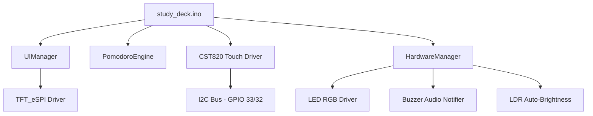
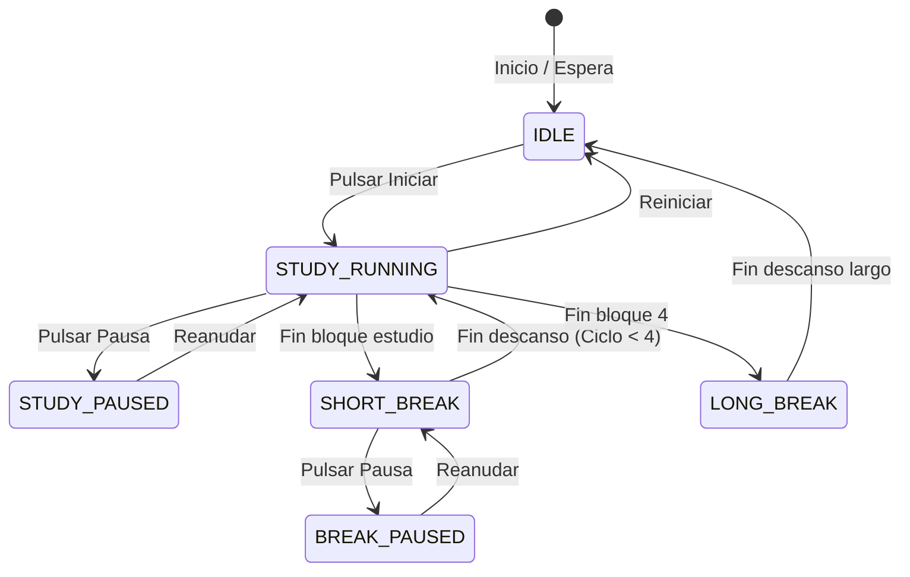

# 🏛️ Arquitectura de Software — Study Deck

Este documento define la estructura y diseño técnico del firmware para el **ESP32 Study Deck**.

---

## 1. Principios de Diseño

1. **Diseño No Bloqueante (Zero Blocking):**
   - El bucle principal (`loop()`) nunca utiliza llamadas a `delay()`.
   - Todas las tareas (actualización del temporizador, lectura del táctil, parpadeo del LED, refresco de pantalla) se ejecutan mediante marcas de tiempo basadas en `millis()`.

2. **Modularidad Estricta:**
   - La lógica de negocio (temporizador Pomodoro) es completamente independiente del motor de renderizado gráfico.
   - Los controladores de hardware (pantalla, táctil, audio, LED) exponen interfaces claras y desacopladas.

3. **Optimización de Memoria (RAM y DMA):**
   - El bus SPI utiliza transacciones rápidas (55 MHz para escritura gráfica).
   - Los buffers de dibujo evitan asignaciones dinámicas repetitivas (`malloc`) para prevenir la fragmentación de la memoria heap del ESP32.

---

## 2. Diagrama de Módulos

---

## 3. Máquina de Estados del Pomodoro

---

## 4. Semáforo de Concentración "No Molestar"

| Estado Pomodoro | Color LED RGB | Modo | Alerta Sonora |
| :--- | :--- | :--- | :--- |
| **Estudio Activo** | 🔴 Rojo | Fijo | Beep corto ascendente al iniciar |
| **Descanso Corto/Largo** | 🟢 Verde | Fijo | Melodía doble al finalizar estudio |
| **Pausado** | 🟡 Amarillo | Parpadeo suave | Sin sonido continuo |
| **En Espera (Idle)** | 🔵 Azul | Apagado / Respiración | Tono de confirmación |

